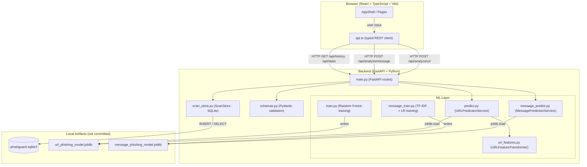

# PhishGuard — Explainable AI-Powered Phishing Detection

PhishGuard is a full-stack security analysis workspace. It uses locally-trained Scikit-learn models to assess URLs and email/SMS messages for phishing risk, returning explainable results backed by real model predictions and independently sourced heuristic indicators. No results are fabricated; the API returns HTTP 503 until a trained model artifact is present.

---

## Problem Statement

Phishing attacks continue to be one of the leading vectors for credential theft, financial fraud, and malware delivery. Existing consumer tools are often opaque black-boxes that provide a verdict without explanation, making it difficult for security-aware users or analysts to understand *why* something is considered suspicious. PhishGuard addresses this gap by:

- Training models locally from documented public datasets with reproducible code.
- Returning model predictions **and** separately labeled heuristic indicators so results can be evaluated independently.
- Storing redacted scan history locally in SQLite — no data is sent to a third-party service.
- Refusing to fabricate results: the API returns a clear `503` if no trained artifact exists rather than returning a mock score.

---

## Features

| Feature | Description |
|---|---|
| **URL scanner** | Analyzes a URL with a trained Random Forest classifier; extracts 23 numeric features without fetching the URL |
| **Message scanner** | Classifies email/SMS text with a TF-IDF + Logistic Regression pipeline; never opens or resolves links |
| **Explainable indicators** | Heuristic signals (IP host, URL shortener, urgency keywords, etc.) displayed separately from the model prediction |
| **Risk scoring** | 0-100 risk score derived from uncalibrated model probability; categorized as Low / Medium / High / Critical |
| **Scan history** | SQLite-backed persistent history with pagination, record details, and individual record deletion |
| **Dashboard statistics** | Total scans, phishing detections, and suspicious result counts |
| **Input redaction** | URL query values, email addresses, phone numbers, and credential tokens are masked before storage |
| **Security disclaimers** | Every result includes a disclaimer that the assessment is informational and not a guarantee of safety |
| **API health check** | `/api/health` shows whether the backend is reachable (does not imply models are trained) |
| **Education page** | Static security-awareness content about phishing warning signs and safer habits |
| **Keyboard navigation** | Skip-to-main-content link, focus trap in the scan details dialog, Escape to close |
| **Responsive layout** | Full sidebar on desktop; slide-in drawer on mobile (<=760 px breakpoint) |

---

## Architecture



**Key design decisions:**

- Model artifacts are loaded lazily on first request and cached with `@lru_cache`; the server does not crash on startup if models are absent — it returns `503` per request.
- Heuristic indicators and model predictions are generated independently and are never mixed or presented as the same signal.
- Input redaction happens in `ScanStore.save()` *before* any write to SQLite; request bodies are never logged by application code.
- CORS origins are configurable via environment variable; the default allowlist is `localhost:5173` and `127.0.0.1:5173`.

---

## Technology Stack

### Backend

| Component | Technology |
|---|---|
| Web framework | FastAPI >= 0.115 |
| ASGI server | Uvicorn (standard extras) |
| ML runtime | Scikit-learn >= 1.6 |
| Model serialization | joblib >= 1.4 |
| TLD extraction | tldextract >= 5.1 |
| Database | SQLite 3 (stdlib) |
| Language | Python 3.10+ |

### Frontend

| Component | Technology |
|---|---|
| Framework | React 19 + TypeScript 5.8 |
| Build tool | Vite 6 |
| CSS | Vanilla CSS (custom design system) |
| Fonts | DM Sans, DM Mono, Manrope (Google Fonts) |
| HTTP client | Fetch API (typed wrapper in `api.ts`) |

### Dev / Test

| Component | Technology |
|---|---|
| Python test runner | pytest >= 8.3 |
| API test client | FastAPI `TestClient` + httpx |

---

## Folder Structure

```
PhishGuard/
├── README.md
├── requirements.txt          # Production Python dependencies
├── requirements-dev.txt      # Dev/test Python dependencies
├── .gitignore
│
├── backend/
│   ├── app/
│   │   ├── __init__.py
│   │   ├── main.py           # FastAPI app, routes, middleware, error handlers
│   │   ├── schemas.py        # Pydantic request/response models with input validation
│   │   ├── ml/
│   │   │   ├── __init__.py
│   │   │   ├── url_features.py      # 23-feature URL transformer + heuristic indicators
│   │   │   ├── predict.py           # URLPredictionService (loads url_phishing_model.joblib)
│   │   │   ├── train.py             # URL Random Forest training CLI
│   │   │   ├── message_predict.py   # MessagePredictionService (loads message_phishing_model.joblib)
│   │   │   └── message_train.py     # Message TF-IDF + LR training CLI
│   │   └── services/
│   │       ├── __init__.py
│   │       └── scan_store.py        # SQLite persistence + input redaction
│   ├── data/
│   │   └── phishguard.sqlite3       # Auto-created at first startup (not committed)
│   ├── models/                      # Auto-created by training scripts (not committed)
│   │   ├── url_phishing_model.joblib
│   │   ├── url_phishing_model.metrics.json
│   │   ├── message_phishing_model.joblib
│   │   └── message_phishing_model.metrics.json
│   └── tests/
│       ├── test_api.py              # API integration tests (monkeypatched models)
│       ├── test_scan_store.py       # SQLite persistence + redaction unit tests
│       ├── test_url_features.py     # URL feature extraction + transformer tests
│       ├── test_url_model.py        # Full train to load to predict roundtrip
│       └── test_message_model.py    # Full message train to predict roundtrip
│
└── frontend/
    ├── index.html
    ├── package.json
    ├── vite.config.ts
    ├── tsconfig.json
    ├── .env.example
    └── src/
        ├── main.tsx          # React entry point
        ├── App.tsx           # Root component: state, routing, scan lifecycle
        ├── api.ts            # Typed REST client for all API endpoints
        ├── styles.css        # Full custom design system (dark theme, responsive)
        ├── components/
        │   ├── AppShell.tsx          # Sidebar, topbar, nav, mobile drawer, API status
        │   ├── Icons.tsx             # Inline SVG icon set
        │   ├── AnalysisResult.tsx    # Risk ring, prediction, indicators, disclaimer
        │   ├── MetricCard.tsx        # Dashboard metric tile
        │   ├── ScanTable.tsx         # Paginated history table with view/delete actions
        │   └── ScanDetailsDialog.tsx # Modal dialog for stored scan details
        └── pages/
            ├── Dashboard.tsx         # Overview: stats, quick-access, recent scans
            ├── ScannerPage.tsx       # URL and message scan form + result display
            ├── HistoryPage.tsx       # Full paginated scan history + deletion
            └── EducationPage.tsx     # Static phishing awareness content
```

---

## Prerequisites

- **Python 3.10+** with pip
- **Node.js 20.19+ or 22.12+** and npm

---

## Installation

Open a terminal in the project root (`PhishGuard/`):

### 1. Python environment

```powershell
python -m venv .venv
.\.venv\Scripts\Activate.ps1
pip install -r requirements.txt
```

> **PowerShell execution policy**: if activation is blocked, run:
> ```powershell
> Set-ExecutionPolicy -Scope CurrentUser RemoteSigned
> ```
> Or invoke Python directly without activating:
> ```powershell
> .\.venv\Scripts\python.exe -m pip install -r requirements.txt
> ```

### 2. Frontend packages

```powershell
cd frontend
npm install
```

---

## Environment Configuration

### Frontend

Copy `.env.example` to `.env.local` to override the default API URL:

```
VITE_API_BASE_URL=http://127.0.0.1:8000
```

The default is `http://127.0.0.1:8000` when no `.env.local` is present.

### Backend

| Variable | Default | Description |
|---|---|---|
| `PHISHGUARD_DATABASE_PATH` | `backend/data/phishguard.sqlite3` | Path to the SQLite database file |
| `PHISHGUARD_MODEL_PATH` | `backend/models/url_phishing_model.joblib` | Path to the trained URL model artifact |
| `PHISHGUARD_MESSAGE_MODEL_PATH` | `backend/models/message_phishing_model.joblib` | Path to the trained message model artifact |
| `PHISHGUARD_CORS_ORIGINS` | `http://127.0.0.1:5173,http://localhost:5173` | Comma-separated CORS allowlist |

---

## Dataset Sources

### URL Model Dataset

**UCI Machine Learning Repository — PhiUSIIL Phishing URL (Website), dataset 967**

- URL: https://archive.ics.uci.edu/dataset/967/phiusiil+phishing+url+dataset
- License: CC BY 4.0
- Size: 235,795 instances (134,850 legitimate, 100,945 phishing)
- Label convention: **`1` = legitimate, `0` = phishing** (pass `--phishing-label 0`)
- Citation: Prasad and Chandra (2024), DOI 10.1016/j.cose.2023.103545

Download the CSV from the UCI record page, extract it, and save it as:

```
data/PhiUSIIL_Phishing_URL_Dataset.csv
```

> The trainer reads **only** the URL and label columns, ignoring all UCI page-content features. This ensures inference requires only a URL string.

### Message Model Dataset

**Kaggle — Phishing Email Detection by subhajournal**

- URL: https://www.kaggle.com/datasets/subhajournal/phishingemails
- License: LGPL-3.0
- File: `Phishing_Email.csv`
- Columns: `Email Text` (body), `Email Type` (label)
- Positive label: **`Phishing Email`**
- Note: This is email data; SMS performance has not been evaluated.

Download the CSV from Kaggle and save it as:

```
data/Phishing_Email.csv
```

> No dataset is downloaded automatically. No dataset file is committed to the repository.

---

## Model Training

Both training scripts must be run from the **`backend/`** directory with the virtual environment active.

### Train the URL model

```powershell
# From PhishGuard/backend/
.\.venv\Scripts\python.exe -m app.ml.train `
  --data ..\data\PhiUSIIL_Phishing_URL_Dataset.csv `
  --url-column URL `
  --label-column label `
  --phishing-label 0
```

> **Output**: `backend/models/url_phishing_model.joblib` and `url_phishing_model.metrics.json`

Training details:

- Extracts 23 URL-only numeric features (no DNS/HTTP requests)
- Deduplicates normalized URLs; fails on conflicting labels
- Uses `StratifiedGroupKFold` (5-fold) grouped by registered domain to prevent domain leakage
- Fits a `RandomForestClassifier` (400 trees, balanced subsample weighting)
- Prints precision, recall, F1, and confusion matrix to stdout

### Train the message model

```powershell
# From PhishGuard/backend/
.\.venv\Scripts\python.exe -m app.ml.message_train `
  --data ..\data\Phishing_Email.csv `
  --text-column "Email Text" `
  --label-column "Email Type" `
  --phishing-label "Phishing Email"
```

> **Output**: `backend/models/message_phishing_model.joblib` and `message_phishing_model.metrics.json`

Training details:

- Lowercased + Unicode-normalized TF-IDF (unigrams + bigrams, up to 250k features)
- Exact-text deduplication with SHA-256; grouped 5-fold split
- `LogisticRegression` with balanced class weighting
- Prints precision, recall, F1, and confusion matrix to stdout

> **Important**: Model `predict_proba` scores are **not calibrated**. Risk scores and model confidence values are derived from uncalibrated probabilities and must not be interpreted as real-world probability of being phishing.

---

## Running the Application

Use **two separate terminals**.

### Terminal 1 — Backend (from `PhishGuard/`)

```powershell
.\.venv\Scripts\Activate.ps1
python -m uvicorn app.main:app --reload --app-dir backend
```

> API available at: `http://127.0.0.1:8000`
> Interactive Swagger docs: `http://127.0.0.1:8000/docs`

**Without activation** (alternative):

```powershell
.\.venv\Scripts\python.exe -m uvicorn app.main:app --reload --app-dir backend
```

### Terminal 2 — Frontend (from `PhishGuard/frontend/`)

```powershell
npm run dev
```

> Frontend available at: `http://127.0.0.1:5173`

The sidebar API status indicator shows whether the backend is reachable. Scan routes return HTTP 503 (with a clear message) until the corresponding trained model artifact is present.

---

## API Endpoint Documentation

All endpoints return JSON. Error responses include a `detail` field. Submitted input values are never echoed in error responses.

### `GET /api/health`

Returns service availability. Does **not** verify that models are trained.

**Response:**

```json
{ "status": "ok", "service": "phishguard-api" }
```

---

### `POST /api/analyze/url`

Analyze a URL with the trained URL phishing model.

**Request body:**

```json
{ "url": "https://example.com/suspicious-path" }
```

- Accepts bare hostnames (`example.com`) or full HTTP/HTTPS URLs
- Max 4,096 characters
- Does not perform DNS lookups or fetch the URL

**Response** (200): Full `AnalysisResponse` object including:

- `prediction`: `"potential_phishing"` or `"no_phishing_detected"`
- `risk_score`: integer 0-100
- `risk_category`: `"low"`, `"medium"`, `"high"`, or `"critical"`
- `indicators`: list of independently sourced heuristic signals
- `model_confidence`: uncalibrated predicted-class score (not a probability)
- `model_info`: algorithm, dataset source, feature schema version
- `disclaimer`: safety disclaimer
- `explanation_note`: clarifies that indicators are heuristics, not model explanations

**Errors:** `422` (invalid URL), `503` (model not trained or artifact missing)

---

### `POST /api/analyze/message`

Classify email or SMS text with the trained message classifier.

**Request body:**

```json
{ "content": "URGENT: Verify your account or it will be suspended." }
```

- Max 30,000 characters
- Never opens or resolves links in the message

**Response** (200): Same `AnalysisResponse` schema as URL analysis.

**Errors:** `422` (empty or too-long content), `503` (model not trained)

---

### `GET /api/history`

Return paginated list of saved scan records.

**Query params:** `limit` (1-200, default 50), `offset` (>=0, default 0)

**Response:**

```json
{
  "items": [
    {
      "id": "...",
      "scan_type": "url",
      "input_excerpt": "...",
      "prediction": "potential_phishing",
      "risk_score": 72,
      "risk_category": "high",
      "created_at": "2026-10-31T12:00:00+00:00"
    }
  ],
  "total": 42,
  "limit": 25,
  "offset": 0
}
```

`input_excerpt` is the redacted input (max 180 chars); the full submitted text is never stored or returned.

---

### `GET /api/history/{scan_id}`

Return full stored result for a single scan.

**Response** (200): Full `AnalysisResponse` object.  
**Errors:** `404` if scan not found.

---

### `DELETE /api/history/{scan_id}`

Delete a scan record.

**Response:** `204 No Content`  
**Errors:** `404` if scan not found.

---

### `GET /api/stats`

Return aggregate scan statistics.

**Response:**

```json
{
  "total_scans": 42,
  "phishing_detections": 17,
  "suspicious_results": 21,
  "url_scans": 30,
  "message_scans": 12,
  "last_scan_at": "2026-10-31T12:00:00+00:00"
}
```

---

## Testing

From the `backend/` directory:

```powershell
# Install dev dependencies (includes pytest + httpx)
pip install -r ..\requirements-dev.txt

# Run all tests
python -m pytest -q
```

### Test coverage

| File | What it tests |
|---|---|
| `test_api.py` | All API endpoints, input validation, model-unavailable 503, storage failure 503, generic error handler (no input echo), health check |
| `test_scan_store.py` | SQLite persistence (save/list/get/delete/stats), URL query redaction, message redaction (email, phone, secrets, URL queries) |
| `test_url_features.py` | Feature extraction correctness, transformer shape/feature order, Pydantic URL validation |
| `test_url_model.py` | Full train to save to load to predict roundtrip with synthetic CSV data |
| `test_message_model.py` | Heuristic indicator detection, full message train to predict roundtrip |

> Tests that exercise model training use synthetic rows in `tmp_path` — they do not use or require the downloaded public datasets.

**Test a running API manually (PowerShell):**

```powershell
# Health check
Invoke-RestMethod -Uri http://127.0.0.1:8000/api/health

# URL analysis (requires trained URL model)
Invoke-RestMethod -Method Post -Uri http://127.0.0.1:8000/api/analyze/url `
  -ContentType 'application/json' `
  -Body '{"url":"https://example.com/"}' | ConvertTo-Json -Depth 8

# Message analysis (requires trained message model)
Invoke-RestMethod -Method Post -Uri http://127.0.0.1:8000/api/analyze/message `
  -ContentType 'application/json' `
  -Body '{"content":"URGENT: verify your account now or it will be suspended."}' | ConvertTo-Json -Depth 8
```

---

## Security and Privacy Notes

- **No external requests**: URL and message analysis never performs DNS lookups, HTTP requests, or page fetches.
- **Input redaction**: URL query values, email addresses, phone numbers, and `key=value` credential tokens are masked before storage. Redaction is best-effort, not anonymization — avoid submitting sensitive personal data.
- **No request logging**: Application code does not log request bodies. FastAPI/Uvicorn access logs include request paths and status codes only.
- **Local model artifacts**: Only load `.joblib` artifacts produced by this project's training scripts from a trusted source. Do not point model path environment variables at untrusted files.
- **SQLite file**: The database file contains redacted excerpts. Protect it with appropriate filesystem permissions.
- **CORS**: Default CORS allowlist is localhost-only. Set `PHISHGUARD_CORS_ORIGINS` when running on a non-default host.

---

## Limitations

1. **No model calibration**: Risk scores are derived from uncalibrated `predict_proba` outputs. The 0-100 score is a relative indicator, not a real-world probability.
2. **Dataset staleness**: Both datasets are static snapshots. Phishing campaigns evolve; accuracy on current threats is unknown.
3. **Email-only message model**: The Kaggle dataset contains email bodies. Performance on SMS, chat, or other short-form messages has not been evaluated.
4. **No page-content analysis**: URL assessment uses only URL-string features. No JavaScript execution, no screenshot, no certificate inspection.
5. **No DNS or WHOIS checks**: Domain age, registration details, and DNS resolution are not used.
6. **Single-fold evaluation**: Metrics are from one 80/20 stratified group split. They reflect training-set performance and are not field accuracy guarantees.
7. **Language**: Both models were trained primarily on English-language content. Multilingual performance is untested.
8. **No real-time blocklist**: The application does not query any threat intelligence feed or blocklist.

---

## Future Enhancements

1. **Model calibration**: Apply Platt scaling or isotonic regression to convert uncalibrated scores into reliable probabilities.
2. **Temporal validation**: Evaluate models on newer, out-of-distribution samples to estimate real-world generalization.
3. **SMS-specific dataset**: Integrate a labeled SMS phishing dataset to evaluate and improve message-model SMS performance.
4. **Certificate and WHOIS features**: Incorporate domain age, certificate transparency logs, and WHOIS data as optional URL features.
5. **Model retraining pipeline**: Automate periodic retraining when new labeled data becomes available.
6. **Export and reporting**: Allow users to export scan history as CSV or JSON for use in security reports.
7. **Bulk URL scanning**: Accept a list of URLs in a single API call for batch workflows.
8. **Dark/light theme toggle**: Currently only a dark theme is provided.

---

## Start Commands (Fresh Terminal)

Open **two** PowerShell terminals in the project root (`PhishGuard/`).

**Terminal 1 — backend:**

```powershell
.\.venv\Scripts\python.exe -m uvicorn app.main:app --reload --app-dir backend
```

**Terminal 2 — frontend (from `PhishGuard/frontend/`):**

```powershell
cd frontend
npm run dev
```

Then open `http://127.0.0.1:5173` in your browser.

> The backend must be started **before** opening the frontend if you want the API status indicator to show as online on first load.
>
> Both models must be trained (see [Model Training](#model-training)) before the URL scanner or message scanner will return results. Until then, scan requests return HTTP 503 with guidance.
