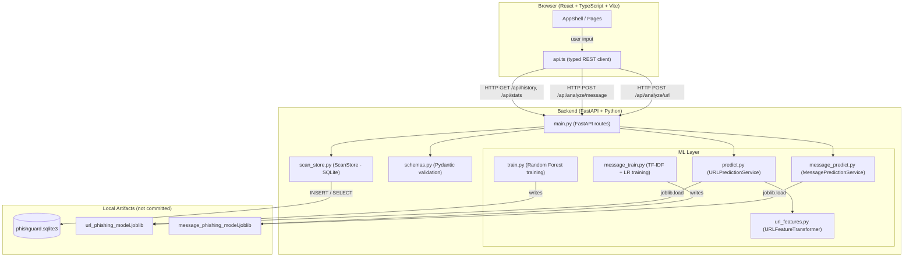

# PhishGuard — Explainable AI-Powered Phishing Detection

PhishGuard is a full-stack security analysis workspace. It uses locally-trained Scikit-learn models to assess URLs and email/SMS messages for phishing risk, returning explainable results backed by real model predictions and independently sourced heuristic indicators. No results are fabricated; the API returns HTTP 503 until a trained model artifact is present.

---

## Problem Statement

Phishing attacks continue to be one of the leading vectors for credential theft, financial fraud, and malware delivery. Existing consumer tools are often opaque black-boxes that provide a verdict without explanation, making it difficult for security-aware users or analysts to understand *why* something is considered suspicious. PhishGuard addresses this gap by:

- Training models locally from documented public datasets with reproducible code.
- Returning model predictions **and** separately labeled heuristic indicators so results can be evaluated independently.
- Storing redacted scan history locally in SQLite — no data is sent to a third-party service.
- Refusing to fabricate results: the API returns a clear `503` if no trained artifact exists rather than returning a mock score.

---

## Features

| Feature | Description |
|---|---|
| **URL scanner** | Scores the URL's hostname with a Random Forest trained on UCI PhiUSIIL (23 numeric features); never fetches or resolves the URL |
| **Message scanner** | Classifies email text with a TF-IDF + Logistic Regression pipeline trained on the Kaggle phishing-email dataset; never opens or resolves links; SMS not validated |
| **Explainable indicators** | MODEL indicators derived from each prediction (random-forest decision-path contributions; TF-IDF × coefficient terms), listed separately from HEURISTIC rule checks |
| **Risk scoring** | 0-100 risk score derived from uncalibrated model probability; categorized as Low / Medium / High / Critical |
| **Scan history** | SQLite-backed persistent history with pagination, record details, and individual record deletion |
| **Dashboard statistics** | Total scans (URL / message split), phishing detections, suspicious result counts, and the newest scans |
| **Input redaction** | URL query values, email addresses, phone numbers, and credential tokens are masked before storage |
| **Security disclaimers** | Every result includes a disclaimer that the assessment is informational and not a guarantee of safety |
| **API and model health** | `/api/health` reports the API and whether each trained model loads; the sidebar shows READY / UNAVAILABLE per model |
| **Education page** | Static security-awareness content about phishing warning signs and safer habits |
| **Keyboard navigation** | Skip-to-main-content link, focus trap in the scan details dialog, Escape to close |
| **Responsive layout** | Full sidebar on desktop; slide-in drawer on mobile (<=760 px breakpoint) |

---

## Architecture



**Key design decisions:**

- Model artifacts are loaded lazily on first request and cached with `@lru_cache`; the server does not crash on startup if models are absent — it returns `503` per request.
- Model-derived explanations (`source: "model"`) and heuristic rule checks (`source: "heuristic"`) are computed independently and always labelled separately.
- The URL pipeline contains its input-scope step (hostname by default), so training and inference always see the same part of the URL.
- Input redaction happens in `ScanStore.save()` *before* any write to SQLite; request bodies are never logged by application code.
- CORS origins are configurable via environment variable; the default allowlist is `localhost:5173` and `127.0.0.1:5173`.

---

## Technology Stack

### Backend

| Component | Technology |
|---|---|
| Web framework | FastAPI >= 0.115 |
| ASGI server | Uvicorn (standard extras) |
| ML runtime | Scikit-learn >= 1.6 |
| Model serialization | joblib >= 1.4 |
| TLD extraction | tldextract >= 5.1 |
| Database | SQLite 3 (stdlib) |
| Language | Python 3.10+ |

### Frontend

| Component | Technology |
|---|---|
| Framework | React 19 + TypeScript 5.8 |
| Build tool | Vite 6 |
| CSS | Custom design system in `styles.css` (Tailwind CSS v4 is imported via `@tailwindcss/vite`) |
| Fonts | DM Sans, DM Mono, Manrope (Google Fonts) |
| HTTP client | Fetch API (typed wrapper in `api.ts`) |

### Dev / Test

| Component | Technology |
|---|---|
| Python test runner | pytest >= 8.3 |
| API test client | FastAPI `TestClient` + httpx |

---

## Folder Structure

```
PhishGuard/
├── README.md
├── requirements.txt          # Production Python dependencies
├── requirements-dev.txt      # Dev/test Python dependencies
├── .gitignore
├── data/                     # Downloaded datasets (gitignored; see Dataset Sources)
├── docs/model-reports/       # Committed evaluation reports from real training runs
│
├── backend/
│   ├── app/
│   │   ├── __init__.py
│   │   ├── main.py           # FastAPI app, routes, middleware, error handlers
│   │   ├── schemas.py        # Pydantic request/response models with input validation
│   │   ├── ml/
│   │   │   ├── __init__.py
│   │   │   ├── url_features.py      # 23-feature URL transformer + heuristic indicators
│   │   │   ├── predict.py           # URLPredictionService (loads url_phishing_model.joblib)
│   │   │   ├── train.py             # URL Random Forest training CLI
│   │   │   ├── message_predict.py   # MessagePredictionService (loads message_phishing_model.joblib)
│   │   │   └── message_train.py     # Message TF-IDF + LR training CLI
│   │   └── services/
│   │       ├── __init__.py
│   │       └── scan_store.py        # SQLite persistence + input redaction
│   ├── data/
│   │   └── phishguard.sqlite3       # Auto-created at first startup (not committed)
│   ├── models/                      # Auto-created by training scripts (not committed)
│   │   ├── url_phishing_model.joblib
│   │   ├── url_phishing_model.metrics.json
│   │   ├── message_phishing_model.joblib
│   │   └── message_phishing_model.metrics.json
│   └── tests/
│       ├── test_api.py                  # API contract tests (stubbed models)
│       ├── test_prediction_workflows.py # Real-service end-to-end workflows + production-artifact checks
│       ├── test_model_explanations.py   # Model-derived explanation correctness
│       ├── test_dataset_loaders.py      # Loader filtering / dedup / conflict handling
│       ├── test_scan_store.py           # SQLite persistence + redaction unit tests
│       ├── test_url_features.py         # URL feature extraction + transformer tests
│       ├── test_url_model.py            # Full train to load to predict roundtrip
│       └── test_message_model.py        # Full message train to predict roundtrip
│
└── frontend/
    ├── index.html
    ├── package.json
    ├── vite.config.ts
    ├── tsconfig.json
    ├── .env.example
    └── src/
        ├── main.tsx          # React entry point
        ├── App.tsx           # Root component: state, routing, scan lifecycle
        ├── api.ts            # Typed REST client for all API endpoints
        ├── styles.css        # Full custom design system (dark theme, responsive)
        ├── components/
        │   ├── AppShell.tsx          # Sidebar, topbar, nav, mobile drawer, API status
        │   ├── Icons.tsx             # Inline SVG icon set
        │   ├── AnalysisResult.tsx    # Risk ring, prediction, indicators, disclaimer
        │   ├── MetricCard.tsx        # Dashboard metric tile
        │   ├── ScanTable.tsx         # Paginated history table with view/delete actions
        │   └── ScanDetailsDialog.tsx # Modal dialog for stored scan details
        └── pages/
            ├── Dashboard.tsx         # Overview: stats, quick-access, recent scans
            ├── ScannerPage.tsx       # URL and message scan form + result display
            ├── HistoryPage.tsx       # Full paginated scan history + deletion
            └── EducationPage.tsx     # Static phishing awareness content
```

---

## Prerequisites

- **Python 3.10+** with pip
- **Node.js 20.19+ or 22.12+** and npm

---

## Installation

Open a terminal in the project root (`PhishGuard/`):

### 1. Python environment

```powershell
python -m venv .venv
.\.venv\Scripts\Activate.ps1
pip install -r requirements.txt
```

> **PowerShell execution policy**: if activation is blocked, run:
> ```powershell
> Set-ExecutionPolicy -Scope CurrentUser RemoteSigned
> ```
> Or invoke Python directly without activating:
> ```powershell
> .\.venv\Scripts\python.exe -m pip install -r requirements.txt
> ```

### 2. Frontend packages

```powershell
cd frontend
npm install
```

### 3. Datasets and models

The scanners return HTTP 503 until their models are trained. Download the datasets ([Dataset Sources](#dataset-sources)), then run the two training commands ([Model Training](#model-training)).

---

## Environment Configuration

### Frontend

By default (no `VITE_API_BASE_URL` set), the frontend calls the API on its own origin, e.g. `http://127.0.0.1:5173/api/...`. The Vite dev server (`npm run dev`) proxies every `/api` request to the backend at `http://127.0.0.1:8000`, configured in `frontend/vite.config.ts`. In development the browser never makes a cross-origin request, so CORS is not involved.

To call a backend directly instead (for example, a different host or port), copy `.env.example` to `.env.local` and set:

```
VITE_API_BASE_URL=http://127.0.0.1:8000
```

The browser then calls that address directly, so the frontend's origin must be in the backend's `PHISHGUARD_CORS_ORIGINS` allowlist. That is already the case for `127.0.0.1:5173` and `localhost:5173`. A production build (`npm run build`) has no dev proxy: either set `VITE_API_BASE_URL` at build time, or serve `/api` from the same origin as the built files.

### Backend

| Variable | Default | Description |
|---|---|---|
| `PHISHGUARD_DATABASE_PATH` | `backend/data/phishguard.sqlite3` | Path to the SQLite database file |
| `PHISHGUARD_MODEL_PATH` | `backend/models/url_phishing_model.joblib` | Path to the trained URL model artifact |
| `PHISHGUARD_MESSAGE_MODEL_PATH` | `backend/models/message_phishing_model.joblib` | Path to the trained message model artifact |
| `PHISHGUARD_CORS_ORIGINS` | `http://127.0.0.1:5173,http://localhost:5173` | Comma-separated CORS allowlist |

---

## Dataset Sources

Datasets are **not** committed and are never downloaded automatically by the app. Place both CSVs in a `data/` folder at the repository root (`data/` is gitignored).

| Model | Dataset | Expected file | Columns used | Phishing label |
|---|---|---|---|---|
| URL | UCI PhiUSIIL Phishing URL (dataset 967), CC BY 4.0 | `data/PhiUSIIL_Phishing_URL_Dataset.csv` | `URL`, `label` | `0` (`1` = legitimate) |
| Message | Kaggle "Phishing Email Detection" by subhajournal, LGPL-3.0 | `data/Phishing_Email.csv` | `Email Text`, `Email Type` | `Phishing Email` (other value: `Safe Email`) |

### URL dataset — UCI PhiUSIIL (no account needed)

- Record page: https://archive.ics.uci.edu/dataset/967/phiusiil+phishing+url+dataset
- 235,795 rows (134,850 legitimate, 100,945 phishing). Citation: Prasad and Chandra (2024), DOI 10.1016/j.cose.2023.103545.
- The trainer reads only `URL` and `label`; the 54 page-content columns are ignored so inference needs nothing but a URL string.

From the repository root (PowerShell):

```powershell
New-Item -ItemType Directory -Force data | Out-Null
Invoke-WebRequest -Uri "https://archive.ics.uci.edu/static/public/967/phiusiil+phishing+url+dataset.zip" -OutFile data\phiusiil.zip
Expand-Archive data\phiusiil.zip -DestinationPath data
Remove-Item data\phiusiil.zip
```

The CSV used for the metrics below has SHA-256 `a236549cd369cd80bd478ff8e1779cbf44c58d5c3f79f7a51a1adbed7d06d1c6` (`Get-FileHash data\PhiUSIIL_Phishing_URL_Dataset.csv`).

### Message dataset — Kaggle (free Kaggle account needed)

1. Sign in at https://www.kaggle.com and open https://www.kaggle.com/datasets/subhajournal/phishingemails
2. Click **Download**, extract the archive, and save `Phishing_Email.csv` as `data/Phishing_Email.csv`.

Or, with the Kaggle CLI and an API token in `%USERPROFILE%\.kaggle\kaggle.json`:

```powershell
pip install kaggle
kaggle datasets download -d subhajournal/phishingemails -p data --unzip
```

The dataset contains email bodies only. Nothing in this project validates SMS classification.

---

## Dataset Preparation

Both loaders (`load_labeled_urls` in `train.py`, `_read_dataset` in `message_train.py`) skip unusable rows instead of aborting, and every decision is counted in the `rows` section of the metrics JSON:

| Decision | URL loader | Message loader |
|---|---|---|
| Wrong number of CSV fields | skipped (`malformed_row`) | skipped (`malformed_row`) |
| Empty input or label | skipped (`missing_url_or_label`) | skipped (`missing_text` / `missing_label`); placeholder bodies `empty`, `nan`, `none`, `null` count as missing |
| Over-length input | > 4,096 chars skipped | > 100,000 chars skipped |
| Unparseable / non-HTTP(S) URL | skipped (`invalid_or_non_http_url`) | — |
| Exact duplicates | first copy kept (scheme/host case, trailing slash, default port normalized) | first copy kept (case and whitespace normalized) |
| Same input with conflicting labels | **every copy dropped** | **every copy dropped** |
| Leakage control for the split | grouped by registered domain (`example.co.uk`) | grouped by a near-duplicate key (links → `url`, digits → `0`, punctuation removed) |

The URL trainer deduplicates a second time on exactly the text the model sees (its input scope, below), so identical model inputs cannot fall on both sides of the split.

Actual PhiUSIIL loader report: 235,795 rows read → 4 skipped (`url_too_long`), 1,823 duplicates removed, 2 conflicting rows dropped → 233,966 unique URLs → 14,774 hostname-level duplicates and 157 hostname-level conflicts removed → **219,035 rows** used for training and evaluation.

---

## Model Training

Run from the **`backend/`** directory. The virtual environment lives in the repository root, hence `..\.venv`.

### Train the URL model

```powershell
cd backend
..\.venv\Scripts\python.exe -m app.ml.train `
  --data ..\data\PhiUSIIL_Phishing_URL_Dataset.csv `
  --url-column URL --label-column label --phishing-label 0
```

About 2 minutes on a laptop. `--input-scope` chooses what part of the URL the model sees:

| `--input-scope` | Model input | Notes |
|---|---|---|
| `hostname` (default, shipped) | hostname without scheme, port, path, query or a leading `www.` | best option PhiUSIIL can validly support |
| `url` | the full URL | learns dataset shortcuts; not recommended (see evaluation) |
| `registered_domain` | e.g. `verify-account.info` | removes almost all signal |

The scope step is part of the saved pipeline, so inference always applies the same reduction. The 23 numeric features are unchanged; RandomForest with 400 trees, balanced class weights, `random_state=42`.

### Train the message model

```powershell
cd backend
..\.venv\Scripts\python.exe -m app.ml.message_train --data ..\data\Phishing_Email.csv
```

Defaults match the Kaggle file (`--text-column "Email Text" --label-column "Email Type" --phishing-label "Phishing Email"`). Pipeline: TF-IDF (unigrams + bigrams, `min_df=2`, sublinear TF, up to 250k terms) + `LogisticRegression` (balanced, liblinear).

Restart the backend after training; `/api/health` and the sidebar then report the model as READY.

---

## Model Evaluation

Both trainers use the first fold of `StratifiedGroupKFold(n_splits=5, shuffle=True, random_state=42)` as an 80/20 holdout and report accuracy, precision, recall, F1 (phishing = positive class) and the confusion matrix. Scores are uncalibrated.

### URL model (trained 2026-11-15, input scope `hostname`)

Held-out test set: 43,806 URLs whose registered domains never appear in the 175,229 training rows (host overlap 0).

| Accuracy | Precision | Recall | F1 |
|---|---|---|---|
| **0.8216** | **0.8655** | **0.6349** | **0.7325** |

| | Predicted legitimate | Predicted phishing |
|---|---|---|
| **Actual legitimate** | 25,296 | 1,662 |
| **Actual phishing** | 6,151 | 10,697 |

Top feature importances: `subdomain_count` 0.367, `hostname_dot_count` 0.137, `url_length` (here: hostname length) 0.091, `host_digit_ratio` 0.089, `hostname_length` 0.086.

Full report: [`docs/model-reports/url_phishing_model.metrics.json`](docs/model-reports/url_phishing_model.metrics.json).

### Shortcut-bias investigation

Every legitimate PhiUSIIL URL is an `https://www.<domain>` homepage: 100% HTTPS, 100% `www.`, 0% with a path, compared with 45%, 47% and 17% of phishing URLs. A depth-3 decision tree using only those three flags reaches **0.9967 accuracy** on the same split. The same RandomForest trained with each input scope:

| Input scope | Accuracy | Precision | Recall | F1 | Top features |
|---|---|---|---|---|---|
| `url` | 0.9981 | 0.9995 | 0.9959 | 0.9977 | `https_present` 0.41, `path_length` 0.20 |
| **`hostname` (shipped)** | **0.8216** | **0.8655** | **0.6349** | **0.7325** | `subdomain_count` 0.37, `hostname_dot_count` 0.14 |
| `registered_domain` | 0.6614 | 0.3691 | 0.5199 | 0.4317 | digit and dot ratios |

The full-URL model's 99.8% mostly reflects the dataset's construction, not phishing detection: in a probe run it scored ordinary GitHub, Wikipedia, docs.python.org and Amazon pages with paths at 1.0 (phishing). The hostname model is shipped because its errors are smaller and visible, but one shortcut remains: legitimate hosts never have subdomains other than `www`, so `subdomain_count` is the top feature. See [`docs/model-reports/url_input_scope_comparison.json`](docs/model-reports/url_input_scope_comparison.json).

Hand-picked probe URLs through the API (a sanity check, **not** an evaluation):

| URL | Score | Result |
|---|---|---|
| `https://www.bbc.co.uk/news` | 7 | no phishing detected |
| `https://www.google.com` | 34 | no phishing detected |
| `https://github.com/python/cpython` | 34 | no phishing detected |
| `https://en.wikipedia.org/wiki/Phishing` | 79 | **false positive** (subdomain) |
| `https://accounts.google.com/signin` | 99 | **false positive** (subdomain + "accounts") |
| `http://192.168.10.5/bank/login.php` | 100 | potential phishing |
| `https://appleid.apple.com.verify-account-locked.info/signin` | 100 | potential phishing |
| `http://login-microsoftonline-verify365.com/` | 96 | potential phishing |

### Message model

Trained 2026-11-15 on Kaggle `Phishing_Email.csv` (SHA-256 `18ef4fff1acb8986f0ab01e83ede6025420c829656af5a377560fce17e153b97`). Loader report: 18,650 rows read → 558 skipped (552 empty/placeholder bodies, 6 over 100,000 characters, including record 12501, a ~17 MB embedded CSV/notebook dump that is not an email) → 585 exact duplicates removed, 0 conflicting labels → **17,507 messages** (10,972 legitimate, 6,535 phishing) in 17,124 near-duplicate groups.

Held-out test set: 3,502 messages, no near-duplicate group shared with the 14,005 training messages (group overlap 0). TF-IDF vocabulary: 250,000 terms.

| Accuracy | Precision | Recall | F1 |
|---|---|---|---|
| **0.9843** | **0.9771** | **0.9809** | **0.9790** |

| | Predicted legitimate | Predicted phishing |
|---|---|---|
| **Actual legitimate** | 2,165 | 30 |
| **Actual phishing** | 25 | 1,282 |

**These scores overstate real-world accuracy.** The terms the model weights most strongly toward *legitimate* are `enron`, `the`, `2002`, `thanks`, `on`, `wrote`, `2001`, `language`, `that`, `attached`, `vince`, `university`, `date`, `2000`, `linguistics`, `edu`. Most legitimate examples come from the early-2000s Enron corporate mailbox and academic and linguistics mailing lists, so the model partly learned "sounds like Enron or a university list" rather than "is safe". Toward *phishing* it weights `your`, `you`, `here`, `our`, `free`, `click here`, `money`, `remove`, `2005`, … — general marketing and second-person language.

Hand-picked probe messages through the API (a sanity check, **not** an evaluation):

| Message (abbreviated) | Score | Result |
|---|---|---|
| "Hi team, attached are the minutes from Tuesday's planning meeting…" | 10 | no phishing detected |
| "Hey, are we still on for dinner Saturday at 7?…" | 36 | no phishing detected |
| "Your Amazon order #112-4432 has shipped and will arrive Thursday…" | 75 | **false positive** (driven by "your", "order") |
| "Hi Priya, your interview with our engineering team is confirmed…" | 67 | **false positive** (driven by "your", "our") |
| "Your account has been suspended. Verify your password within 24 hours…" | 85 | potential phishing |
| "Congratulations! You have won a $1000 gift card. Click here…" | 98 | potential phishing |
| "Dear customer, we detected unusual sign-in activity. Confirm your banking details…" | 86 | potential phishing |

The full report, including the 20 strongest terms in each direction, is written to `backend/models/message_phishing_model.metrics.json` when you train.

---

## Model Explanations

Each result lists **MODEL** indicators (derived from the trained model for this specific input) before **HEURISTIC** indicators (independent rule checks). They are never mixed.

- **URL model:** an exact decision-path decomposition of the random forest (the "treeinterpreter" method). In each tree, the change in phishing probability at every split is credited to the feature used there. Averaged over the 400 trees, the baseline score (the training average, about 50/100) plus all contributions equals the model's score exactly. The up to 4 features that moved the score by at least 1 point are shown, for example `Subdomain labels = 1 — raised the model's phishing score by 33 points`. Adds about 220 ms per request.
- **Message model:** for each term in the message, the contribution is its TF-IDF weight × the logistic-regression coefficient, in log-odds. Up to 6 terms are shown, each marked as pushing toward phishing or toward legitimate.

These explain what the model did, not whether it is right. A large contribution from `subdomain_count` on a legitimate site is the dataset bias described above.

---

## Model Artifacts

| File | Created by | In Git? |
|---|---|---|
| `backend/models/url_phishing_model.joblib` (~41 MB) | `app.ml.train` | no (gitignored; regenerate with the command above) |
| `backend/models/url_phishing_model.metrics.json` | `app.ml.train` | no; a copy of the shipped run is in `docs/model-reports/` |
| `backend/models/message_phishing_model.joblib` | `app.ml.message_train` | no |
| `backend/models/message_phishing_model.metrics.json` | `app.ml.message_train` | no |

Artifacts are loaded once per process and must match feature schema version 3. Older artifacts are rejected with a "Retrain" message. Override locations with `PHISHGUARD_MODEL_PATH` / `PHISHGUARD_MESSAGE_MODEL_PATH`.

---

## Running the Application

Use **two separate terminals**.

### Terminal 1 — Backend (from `PhishGuard/`)

```powershell
.\.venv\Scripts\Activate.ps1
python -m uvicorn app.main:app --reload --app-dir backend
```

> API available at: `http://127.0.0.1:8000`
> Interactive Swagger docs: `http://127.0.0.1:8000/docs`

**Without activation** (alternative):

```powershell
.\.venv\Scripts\python.exe -m uvicorn app.main:app --reload --app-dir backend
```

### Terminal 2 — Frontend (from `PhishGuard/frontend/`)

```powershell
npm run dev
```

> Frontend available at: `http://127.0.0.1:5173`

The sidebar API status indicator shows whether the backend is reachable. Scan routes return HTTP 503 (with a clear message) until the corresponding trained model artifact is present.

---

## API Endpoint Documentation

All endpoints return JSON. Error responses include a `detail` field. Submitted input values are never echoed in error responses.

### `GET /api/health`

Returns service availability and whether each trained model artifact loads. It performs no detection.

**Response:**

```json
{
  "status": "ok",
  "service": "phishguard-api",
  "models": {
    "url": { "available": true, "model_version": "2026-11-15T09:25:15.912030+00:00" },
    "message": { "available": false, "detail": "The message model is not trained or the artifact is missing. ..." }
  }
}
```

---

### `POST /api/analyze/url`

Analyze a URL with the trained URL phishing model.

**Request body:**

```json
{ "url": "https://example.com/suspicious-path" }
```

- Accepts bare hostnames (`example.com`) or full HTTP/HTTPS URLs
- Max 4,096 characters
- Does not perform DNS lookups or fetch the URL

**Response** (200): Full `AnalysisResponse` object including:

- `prediction`: `"potential_phishing"` or `"no_phishing_detected"`
- `risk_score`: integer 0-100
- `risk_category`: `"low"`, `"medium"`, `"high"`, or `"critical"`
- `indicators`: list of independently sourced heuristic signals
- `model_confidence`: uncalibrated predicted-class score (not a probability)
- `model_info`: algorithm, dataset source, feature schema version
- `disclaimer`: safety disclaimer
- `explanation_note`: clarifies that indicators are heuristics, not model explanations

**Errors:** `422` (invalid URL), `503` (model not trained or artifact missing)

---

### `POST /api/analyze/message`

Classify email or SMS text with the trained message classifier.

**Request body:**

```json
{ "content": "URGENT: Verify your account or it will be suspended." }
```

- Max 30,000 characters
- Never opens or resolves links in the message

**Response** (200): Same `AnalysisResponse` schema as URL analysis.

**Errors:** `422` (empty or too-long content), `503` (model not trained)

---

### `GET /api/history`

Return paginated list of saved scan records.

**Query params:** `limit` (1-200, default 50), `offset` (>=0, default 0)

**Response:**

```json
{
  "items": [
    {
      "id": "...",
      "scan_type": "url",
      "input_excerpt": "...",
      "prediction": "potential_phishing",
      "risk_score": 72,
      "risk_category": "high",
      "created_at": "2026-10-31T12:00:00+00:00"
    }
  ],
  "total": 42,
  "limit": 25,
  "offset": 0
}
```

`input_excerpt` is the redacted input (max 180 chars); the full submitted text is never stored or returned.

---

### `GET /api/history/{scan_id}`

Return full stored result for a single scan.

**Response** (200): Full `AnalysisResponse` object.  
**Errors:** `404` if scan not found.

---

### `DELETE /api/history/{scan_id}`

Delete a scan record.

**Response:** `204 No Content`  
**Errors:** `404` if scan not found.

---

### `GET /api/stats`

Return aggregate scan statistics.

**Response:**

```json
{
  "total_scans": 42,
  "phishing_detections": 17,
  "suspicious_results": 21,
  "url_scans": 30,
  "message_scans": 12,
  "last_scan_at": "2026-10-31T12:00:00+00:00"
}
```

---

## Testing

From the repository root:

```powershell
.\.venv\Scripts\python.exe -m pip install -r requirements-dev.txt
.\.venv\Scripts\python.exe -m pytest -q
```

With both models trained, the latest run gives **63 passed, 0 skipped**. Tests that check the production models run only when the matching artifact exists in `backend/models/` and are reported as skipped otherwise. On a fresh clone without trained models, expect the 6 URL and 2 message production tests to be skipped.

### Test coverage

| File | Tests | What it covers |
|---|---|---|
| `test_api.py` | 11 | All endpoints with stubbed models: validation, 503 when a model is unavailable, storage failure, the generic error handler (input never echoed), health shape |
| `test_prediction_workflows.py` | 20 | Real, non-stubbed services: request → model → SQLite → history round trip; missing, corrupt and wrong-schema artifacts → 503 and health "unavailable"; invalid inputs → 422; production-artifact checks |
| `test_model_explanations.py` | 5 | The forest decomposition sums exactly to the model score; indicator formatting and threshold; message-term contributions; model-before-heuristic ordering |
| `test_dataset_loaders.py` | 4 | Skipped-row reasons and counts, duplicate and conflicting-label handling, near-duplicate grouping |
| `test_scan_store.py` | 5 | SQLite persistence, redaction, explicit database path wins over the env var |
| `test_url_features.py` | 12 | Feature extraction, transformer shape and order, URL validation |
| `test_url_model.py` / `test_message_model.py` | 1 / 3 | Train → save → load → predict round trips |

> Model tests train on small fixtures written to `tmp_path`. These are never used as training data for the shipped models or for any reported metric.

The frontend has no automated tests. Check it with `npm run build` (TypeScript + Vite).

**Test a running API manually (PowerShell):**

```powershell
Invoke-RestMethod -Uri http://127.0.0.1:8000/api/health | ConvertTo-Json -Depth 4

Invoke-RestMethod -Method Post -Uri http://127.0.0.1:8000/api/analyze/url `
  -ContentType 'application/json' `
  -Body '{"url":"https://example.com/"}' | ConvertTo-Json -Depth 8

Invoke-RestMethod -Method Post -Uri http://127.0.0.1:8000/api/analyze/message `
  -ContentType 'application/json' `
  -Body '{"content":"URGENT: verify your account now or it will be suspended."}' | ConvertTo-Json -Depth 8
```

---

## Security and Privacy Notes

- **No external requests**: URL and message analysis never performs DNS lookups, HTTP requests, or page fetches.
- **Input redaction**: URL query values, email addresses, phone numbers, and `key=value` credential tokens are masked before storage. Redaction is best-effort, not anonymization — avoid submitting sensitive personal data.
- **No request logging**: Application code does not log request bodies. FastAPI/Uvicorn access logs include request paths and status codes only.
- **Local model artifacts**: Only load `.joblib` artifacts produced by this project's training scripts from a trusted source. Do not point model path environment variables at untrusted files.
- **SQLite file**: The database file contains redacted excerpts. Protect it with appropriate filesystem permissions.
- **CORS**: Default CORS allowlist is localhost-only. Set `PHISHGUARD_CORS_ORIGINS` when running on a non-default host.

---

## Limitations

1. **The URL dataset's legitimate class is homepages only.** Every legitimate PhiUSIIL example is `https://www.<domain>`. The shipped model therefore scores only the hostname and ignores paths and scheme. It still over-scores legitimate sites on non-`www` subdomains (`accounts.google.com` scores 99, `en.wikipedia.org` 79). Phishing signals in the path, such as `/login/verify`, appear only as heuristic indicators.
2. **Moderate URL performance.** On held-out domains: accuracy 0.82, precision 0.87, **recall 0.63**. About a third of phishing hostnames in the test set were missed.
3. **The message dataset is biased by where its emails came from.** Legitimate examples are mostly early-2000s Enron and academic or linguistics mailing-list emails, so terms like `enron`, `vince`, `2001`/`2002`, `university` and `edu` signal "legitimate". Modern legitimate emails that address the reader ("your order", "our team") can be flagged: a shipping notice scored 75 and an interview confirmation 67. The 0.98 held-out accuracy measures this dataset, not today's inboxes.
4. **No calibration.** Risk scores come from uncalibrated `predict_proba` outputs of both models; treat the 0–100 score as relative, not as a probability.
5. **One holdout split.** Metrics come from one domain- or near-duplicate-grouped 80/20 split, not cross-validation. They describe held-out performance on these datasets, not field accuracy.
6. **Static, dated datasets.** Phishing campaigns change; accuracy on current threats is unknown.
7. **No page, DNS, WHOIS, certificate or blocklist checks.** Nothing is fetched or resolved.
8. **Explanations describe the model, not the truth.** A large contribution shows what drove the score, including dataset artifacts.
9. **SMS is not validated.** The message model was trained and evaluated on email bodies only. It accepts SMS text, but no SMS data was used to measure its accuracy.

---

## Future Enhancements

1. **Model calibration**: Apply Platt scaling or isotonic regression to convert uncalibrated scores into reliable probabilities.
2. **Temporal validation**: Evaluate models on newer, out-of-distribution samples to estimate real-world generalization.
3. **SMS-specific dataset**: Integrate a labeled SMS phishing dataset to evaluate and improve message-model SMS performance.
4. **Certificate and WHOIS features**: Incorporate domain age, certificate transparency logs, and WHOIS data as optional URL features.
5. **Model retraining pipeline**: Automate periodic retraining when new labeled data becomes available.
6. **Export and reporting**: Allow users to export scan history as CSV or JSON for use in security reports.
7. **Bulk URL scanning**: Accept a list of URLs in a single API call for batch workflows.
8. **Dark/light theme toggle**: Currently only a dark theme is provided.

---

## Start Commands (Fresh Terminal)

Open **two** PowerShell terminals in the project root (`PhishGuard/`).

**Terminal 1 — backend:**

```powershell
.\.venv\Scripts\python.exe -m uvicorn app.main:app --reload --app-dir backend
```

**Terminal 2 — frontend (from `PhishGuard/frontend/`):**

```powershell
cd frontend
npm run dev
```

Then open `http://127.0.0.1:5173` in your browser.

> The backend must be started **before** opening the frontend if you want the API status indicator to show as online on first load.
>
> Each scanner returns results only after its model is trained (see [Model Training](#model-training)). Until then, that scanner shows an "unavailable" banner and its requests return HTTP 503 with guidance. The sidebar shows READY / UNAVAILABLE per model.
